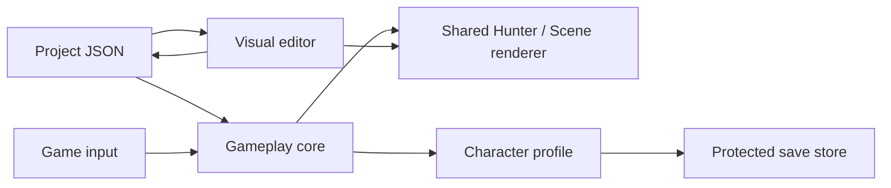

# Working on your game

The project now has three layers: the rendering-independent gameplay core,
the shared rendering/assets code, and a visual project editor. Start with the
editor; move into Rust when you need a feature the inspector cannot express.

## Open the Windows engine kit

Extract `phantasy-star-engine-windows-x64.zip` into a writable folder. Keep its
files together. `Start-Editor.cmd` opens `projects/starter/project.json`.
`Play-Project.cmd` starts an isolated playtest of that project. Drag another
project JSON onto either launcher to use it instead. No Rust installation is
needed to run the editor or tune project settings.

`phantasy-star.exe` starts the actual saved game. A missing save opens the
[character creator](character-creator.md). Normal play saves progression and
appearance under the user's application-data directory. Editor playtests
always disable character saves, even if `PSP_SAVE_PATH` is set.

## Learn the editor

| Tab or action | What you can do |
| --- | --- |
| Character | Default name, helmet/hair style, body preset, armor/accent/skin/hair palettes |
| Animation | Preview the same clips as the game, select weapon mesh, play/pause, scrub time, change playback speed, show bones |
| Animation energy | Persist the strength of the authored attack poses; the same value is used by the game |
| Gameplay → Movement | Walk/sprint speed, jump impulse, gravity |
| Gameplay → Enemy / PP | Enemy approach speed, damage multiplier, passive PP regeneration |
| Gameplay → Sword / Partisan / Knuckles | Damage, reach and attack-speed multipliers for that class and its PA |
| Scene | Select lobby/field, add/remove props, select with arrows, change position/size, cycle colors |
| Help | On-screen workflow and keyboard shortcuts |
| Ctrl+S / Save | Validate and save the current project; preserve the previous valid file as a backup |
| F6 / Play | Save and launch the game with that project, without touching a player save |
| Ctrl+Z / Ctrl+Y | Undo / redo up to 64 edit snapshots |
| Reload / Ctrl+R | Reread JSON; repeat the action to explicitly discard unsaved changes |
| Middle mouse drag over preview | Orbit the preview camera |

Playback speed is a preview control. **Attack speed multiplier** is what changes
combat timing. The preview timeline uses the authored clip's base duration;
the game scales playback to the active attack duration. Weapon mesh and clip
selection are independent so you can inspect any pose with any weapon.

The Scene tab edits additional beveled box props. All are solid; their width
and depth feed the exact same terrain collision used by players and enemies.
The game camera uses their height. The project can contain 32 additional props.
Existing terrain and base obstacles remain code-authored. The editor marks
selected props yellow, invalid props red, and protected interaction areas cyan.
It refuses props over spawns, the mission terminal, return pad and shop. Other
invalid edits remain visible for correction, but cannot be saved or played.

## Your first changes

**Make a faster Hunter.** Gameplay → Movement → raise Walk speed slightly. Keep
Sprint speed at least as high. Save and F6; use WASD and Shift in the game.

**Try a stronger sword.** Gameplay → Sword → set Damage multiplier to 1.2.
Start a playtest and check the HUD's attack power. Enter the trial; normal and
PA damage both use the multiplier, captured when an attack begins.

**Place a prop.** Scene → choose a scene → Add prop. Use Position to move it,
Size for width/height/depth, and Color to cycle presets. F6 verifies placement
in the running game. Props on the initial spawn or an interaction are rejected.

**Inspect a strike.** Animation → choose the weapon mesh and clip → Pause.
Drag Timeline through wind-up, damage contact and recovery. Show bones to
inspect the grip. Change Animation energy to alter the attack silhouette.
Detailed pose editing lives in `hunter.rs`, as described below.

## Project data and player saves

`projects/starter/project.json` is design data. Copy its whole directory to make
another project. The project format has version 1, a display name, default
character, gameplay settings and a prop list. Unknown fields, unsupported
versions, excessive input, invalid names, out-of-range numbers and invalid
placements are rejected. Project files are bounded to 512 KiB.

Character appearance is represented by palette indices. Armor/accent/hair
indices run 0–5, skin 0–4, head 0–2 (helmet, cropped, spiky), and build 0–2
(slim, balanced, broad). The exact material palettes live in `hunter.rs`.
Appearance is cosmetic and does not change collision or damage.

| Setting | Supported values | Default |
| --- | --- | --- |
| Walk speed | 1–8 units/s | 4 |
| Sprint speed | 2–12, at least walk speed | 6.5 |
| Jump speed | 3–12 | 7 |
| Gravity | 8–35 | 20 |
| PP recovery | 0–20 PP/s | 5 |
| Enemy approach speed | 0.5–6 | 2.8 |
| Enemy damage | 0.25–3 multiplier | 1 |
| Animation energy | 0.6–1.4 | 1 |
| Each weapon's power/reach/speed | 0.5–2 multiplier | 1 |
| Prop width/height/depth | 0.3–4 units | New props: 1.5 / 1.8 / 1.5 |

Example prop entry inside `props`:

```json
{
  "scene": "lobby",
  "x": -8.0, "z": -8.0,
  "width": 1.5, "height": 1.8, "depth": 1.5,
  "color": [48, 153, 180]
}
```

Use `"field"` for the training scene. Position is the ground center; the prop
stands on the floor. Save settings are separate: [saving.md](saving.md) explains
version 2 profiles, backups and version 1 migration. Project settings are applied
at launch and after Return to lobby; they are not copied into character saves.
The editor detects external file changes and requires reload before saving.

## Install the source toolchain

The engine kit includes the source for the exact release under `source/`.
You can also clone the repository and check out the matching preview tag.
The build needs stable Rust and Cargo, plus Windows MSVC linker/SDK tools.
Use the official [Rust installer](https://rust-lang.org/tools/install/) and
follow the prompts for the [Windows MSVC prerequisites](https://rust-lang.github.io/rustup/installation/windows-msvc.html).
For a manual Visual Studio setup, the Rust documentation lists the **Desktop
development with C++** workload. Reopen your terminal after installation so
Cargo is on PATH. The first build downloads Cargo dependencies; keep internet
access available. The source package does not bundle a compiler or dependencies.

Open `source/Build-Engine.cmd` in the engine kit, or `tools/Build-Engine.cmd` in a
repository checkout. It builds the release executables and opens the editor
against the source project's own `projects/starter/project.json`.

From a terminal in the directory containing `Cargo.toml`:

```sh
cargo run --locked --features viewer --bin engine-editor
cargo run --locked --features viewer --bin phantasy-star
cargo run --locked --features viewer --bin phantasy-star -- --project projects/starter/project.json --playtest
cargo build --release --locked --features viewer --bin phantasy-star --bin engine-editor --bin model-viewer --bin psp-client
```

Build outputs are in `target/release/`. Run the editor from the project root,
pass `--project` explicitly, or copy `projects/` beside the built executables.
Keep `phantasy-star` beside `engine-editor` for F6. On Windows the files have
`.exe` extensions. Linux/macOS builds use the same Rust commands with their
platform graphics/build prerequisites.

## Find the code you want to change

| Your change | Start here |
| --- | --- |
| Character choices and validation | `crates/game-core/src/character.rs` |
| Creator and shared appearance inspector | `crates/client/src/character_ui.rs` |
| Player mesh, material palettes, grip and authored poses | `crates/client/src/hunter.rs` |
| Add a weapon class or PA | `crates/game-core/src/weapon.rs` |
| Weapon ownership and class compatibility | `crates/game-core/src/inventory.rs` |
| Shop stock/prices and wallet rules | `crates/game-core/src/shop.rs` |
| Simulation, movement, enemy AI, timing, collision | `crates/game-core/src/world.rs` |
| Validated project ranges and scene prop rules | `crates/game-core/src/settings.rs` |
| Quests, levels, rewards and health | `crates/game-core/src/lib.rs` |
| Project JSON conversion, validation, file I/O and launch arguments | `crates/client/src/project.rs` |
| Editor tabs, preview controls, undo/redo, playtest launch | `crates/client/src/editor.rs` |
| Game input, camera, frame loop and game UI routing | `crates/client/src/game.rs` |
| Damage feedback, HUD and action palette | `crates/client/src/combat_ui.rs` |
| Static lobby/forest scenery and shared UI style | `crates/client/src/presentation.rs` |
| Character save conversion and protected writes | `crates/client/src/saves.rs` |
| OBJ/Aqua/ICE/rig imports and clip sampling | `crates/assets/src/` |
| Windows build and packaging | `.github/workflows/windows-release.yml` |



Keep rules in the core and visual effects in the client. A camera or mesh should
never award XP, spend currency or apply a hit. Never put file paths or JSON
parsing into core collision code. The project layer validates data before it
configures the core. This separation also keeps a future server practical.

To add a new weapon class, define its attack spec and compatible PA, update
inventory/shop and save item names, then add its mesh/clip selection to Hunter.
A new class also needs a project balance field, editor page and round-trip tests.
To alter an existing animation, edit `authored_pose` in `hunter.rs` and inspect it
in Animation. `contact_fraction` reads gameplay timing; `anime_phase` controls
anticipation, fast contact and recovery. Keep the right-palm grip socket intact.
Imported PSO2 files are optional research assets and must remain unbundled.

## Check and share your work

```sh
cargo fmt --all -- --check
cargo test --workspace --all-features --locked
cargo clippy --workspace --all-features --all-targets --locked -- -D warnings
python3 -m unittest discover -s tools -p 'test_*.py'
```

The Rust tests verify project validation, atomic configuration, collision,
attack snapshots, save migration, external-file protection and clip stability.
A graphical editor smoke check edits, saves, reloads and previews a throwaway
project; optionally it launches the actual game through the same play action.
Do not use your starter project as a smoke-test target, since smoke edits save.

For project-only changes, share a copy of the project directory with someone
using the same engine version. For Rust changes, rebuild the executables and
keep them beside your project data. Retain THIRD_PARTY_NOTICES.md and the font
license. The Windows workflow produces game and engine kits and a source ZIP;
it does not automatically publish a GitHub release.

## Current boundaries

This workbench is intentionally specific to the current solo game. It provides
appearance presets, clip inspection, pose-energy control, balance editing,
box-prop placement and playtesting. It does not provide general scene graphs,
freeform mesh modeling, skeletal curve editing, arbitrary imported-model scene
placement, scripting, terrain sculpting, custom quest editing or a general
standalone-game exporter. Those features can be added in Rust; the full source
and data formats are included so the project can grow in that direction.
